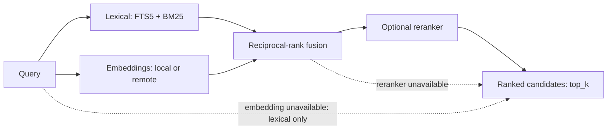

# MCP routing

Skillmux exposes its configured vault checkout through two Model Context
Protocol tools. A vault source of truth is the logical collection; a checkout
is its physical copy. Choose a transport based on where the process runs:

| Topology | Transport | Typical package |
| --- | --- | --- |
| Skillmux beside one client | stdio | Skillmux CLI |
| Shared Skillmux server | Streamable HTTP | Full image by default; slim image for remote or lexical retrieval |

Both transports expose the same `resolve_skill` and `fetch_skill` contract.
Local native pinning is optional and can run beside stdio MCP.

## Register a stdio server

Start the server:

```sh
skillmux index
skillmux doctor
skillmux serve
```

Register the command in your MCP client:

```json
{
  "mcpServers": {
    "skillmux": {
      "command": "skillmux",
      "args": ["serve"]
    }
  }
}
```

The default transport is stdio. The process exits when the client closes its
input stream or sends a termination signal.

## Connect to a shared HTTP service

Start a Streamable HTTP server:

```sh
skillmux serve --transport http --port 3000
```

Clients send MCP requests to:

```text
http://127.0.0.1:3000/mcp
```

The default host accepts loopback connections only. Configure authentication
and network exposure before serving other machines. See
[Deployment](deployment.md#expose-http-safely).

This is the MCP surface for AI clients. Its bearer token applies only to
`/mcp`; server configuration uses the separate operator surface at
`/admin/v1/*`. AI clients do not need the CLI to use `/mcp`; named CLI contexts
are for administering the deployed server, not remote agent skill directories.
See [Deployment](deployment.md#http-surfaces).

## Protocol versions

Both transports serve two MCP protocol eras, chosen by the client:

| Era | Versions | How a client opens |
| --- | --- | --- |
| Modern | `2026-07-28` | `server/discover`, then requests that each carry the `_meta` envelope (`io.modelcontextprotocol/protocolVersion`, `clientCapabilities`, `clientInfo`). No `initialize`, no session. |
| Legacy | `2025-11-25`, `2025-06-18`, `2025-03-26`, `2024-11-05`, `2024-10-07` | The `initialize` / `notifications/initialized` handshake. |

Over stdio, the first message on a connection selects its era, and the
connection stays pinned to that era until it closes. A `server/discover` probe
does not pin it, so a client may probe and then send `initialize` on the same
connection. Over HTTP every request stands alone. See
[Deployment](deployment.md#stateless-mcp-over-http).

On `2026-07-28`, every result carries `resultType` and stamps
`_meta["io.modelcontextprotocol/serverInfo"]` with the Skillmux name and
version. `tools/list` results are cacheable for an hour (`ttlMs: 3600000`,
`cacheScope: "private"`): the tool set is fixed for the life of the process, so
the server does not advertise `tools.listChanged`. A request that claims a
protocol version the server does not support gets JSON-RPC error `-32022`
(UnsupportedProtocolVersion) with the supported versions.

The tool contract below is the same in both eras. Only the protocol envelope
differs.

## Tool contract

### `resolve_skill`

Input:

```json
{
  "query": "convert this spreadsheet to a Markdown table",
  "top_k": 5
}
```

Skillmux returns a ranked candidates response:

```json
{
  "request_id": "3fae2b8e-6c2d-4b1a-9d7a-2b6c5b6a9e10",
  "retrieval": "reranked",
  "candidates": [
    {
      "rank": 1,
      "skill_id": "csv-formatter",
      "description": "Convert CSV and spreadsheets into formatted Markdown tables.",
      "score": 0.92
    }
  ]
}
```

- `request_id`: a unique id minted for this resolve. Pass it back to `fetch_skill` to correlate a fetch outcome with this resolve and the fetched skill's rank in this shortlist.
- `retrieval`: the effective retrieval capability (`reranked`, `hybrid`, or `lexical`).
- `candidates`: zero through effective `top_k` candidates ordered by descending score with contiguous 1-based ranks.
- If reranking or embedding fails, degradation metadata (`degraded_from`, `degradation_reason`) is included.

### `fetch_skill`

Input:

```json
{
  "skill_id": "csv-formatter",
  "request_id": "3fae2b8e-6c2d-4b1a-9d7a-2b6c5b6a9e10"
}
```

The response has two text content blocks: first the current `SKILL.md` body,
verbatim, then a JSON object with the skill ID, title, content SHA-256,
supporting-file paths, and `fetch_id`. It carries no `structuredContent`, because some clients
show the model only `structuredContent` when it is present, which would drop
the body. `request_id` is optional. When it names a resolve that
minted it, the recorded fetch outcome links to that resolve and its rank in
the shortlist. An absent, unknown, or malformed `request_id` still succeeds
and records an uncorrelated fetch — delivery never fails because telemetry
could not correlate. Fetch does not depend on an earlier resolve call.

To read a supporting file from a remote vault, pass one path from `files`:

```json
{
  "skill_id": "csv-formatter",
  "path": "references/notes.md",
  "parent_fetch_id": 42
}
```

Use the main response's `fetch_id` for `parent_fetch_id`. You can omit it;
an unknown ID or an ID for another skill records a null parent and delivery
still succeeds. Supplying `parent_fetch_id` requires `path`.

The first text block contains the requested file verbatim. The metadata block
includes `path`, `byte_length`, `parent_fetch_id`, and the SHA-256 of those file
bytes, alongside the skill ID, title, and supporting-file list. Attachment
responses omit `fetch_id`. Both transports use this shape.

Supporting files must contain valid UTF-8 text and fit within 256 KiB (262144
bytes). Empty files work. Skillmux preserves BOMs and line endings. It rejects
C0 controls except tab, LF, and CR, and rejects DEL. It does not truncate files
or encode binary content. Error messages start with a stable code:

- `INVALID_FILE_PATH`: an absolute path, backslash, NUL, empty/dot/parent
  segment, or a parent ID without `path`.
- `FILE_NOT_FOUND`: a path outside `files`, an unavailable file, a directory,
  or a symlinked component.
- `FILE_TOO_LARGE`: a file above the byte limit.
- `FILE_NOT_TEXT`: invalid UTF-8 or binary control characters.

The complete wire contract lives in [schema.json](schema.json).

## Recommended agent behavior

Give the calling client these rules:

1. Call `resolve_skill` when a task may benefit from a specialized workflow.
2. Review the returned ranked candidates shortlist.
3. If a relevant candidate exists, call `fetch_skill` with its `skill_id` to retrieve complete instructions, passing back the resolve's `request_id` when the client retains it.
4. If no candidate is relevant (or `candidates` is empty), continue under your normal workflow.

Passing `request_id` is optional and never required for delivery, but it is
what lets Skillmux measure whether a returned shortlist was actually used.

## Retrieval pipeline



Skillmux builds candidates in stages:

1. Skillmux places complete skill ID matches first in the lexical list, followed
   by complete title matches and SQLite FTS5 matches ranked with BM25.
2. Local or remote embeddings rank semantic similarity.
3. Reciprocal-rank fusion combines both lists.
4. An optional reranker scores the fused candidates.
5. Returns up to effective `top_k` ranked candidates.

The lexical index includes skill IDs, titles, descriptions, and aliases.
Search keeps single-character terms such as `R` and distinguishes `C++`, `C#`,
and `C`. Complete ID/title matching trims surrounding whitespace and ignores
ASCII letter case. The lexical budget (`recall.k_lexical`) includes these exact
matches. RRF and the reranker can change their position in the final shortlist.

Skillmux wraps the Unicode tokenizer with SQLite's English Porter stemmer for
both indexed terms and MATCH queries. Word forms such as `debug`/`debugging`,
`deploy`/`deploying`, and `test`/`tests` can match each other. Skill metadata and
the query text sent to embeddings and reranking keep their original spelling.
Complete ID/title matching still compares the original metadata.

Porter follows English suffix rules rather than expanding synonyms or matching
arbitrary substrings. Some different words share a stem, which can add less
relevant candidates. It does not add Chinese word segmentation or guarantee
word-form matching in other languages. See the
[SQLite Porter tokenizer documentation](https://www.sqlite.org/fts5.html#porter_tokenizer).

On first opening an older index, Skillmux rebuilds the FTS table from stored
skill metadata in a transaction. It preserves skill rows, vectors, and existing
index metadata, so this upgrade does not require embedding backfill.

The default local inference configuration uses FTS5 and quantized
`Xenova/gte-small` embeddings. Skillmux CLI installations cache the
downloaded model under `~/.cache/skillmux/models`; the full image
includes it. The slim image starts with lexical retrieval and can call an
OpenAI-compatible embedding endpoint.

Remote inference also supports `jina-v1` or `bifrost-v1` reranker adapters.

Read [Configuration](configuration.md#local-inference) for local and remote
inference settings.

## Fallback and readiness

Skillmux advertises the capability it can support:

- embedding failure falls back to lexical retrieval;
- reranker failure preserves the hybrid shortlist;
- vault or index failure marks the server unready.

Check the active mode:

```sh
skillmux doctor
curl http://127.0.0.1:3000/health/ready
```

A ready server reports `lexical`, `hybrid`, or `reranked` along with skill and
index status.

## Content integrity

The index stores metadata and retrieval state. Delivery reads the file from
disk, computes its SHA-256, and returns those current bytes. If indexed
metadata has gone stale, Skillmux refreshes it before delivery.

Supporting files remain in the vault. Read a listed text file with
`fetch_skill(skill_id, path)` over MCP, or use your configured filesystem access
when the vault is local. Attachment reads use the same selected vault root as
SKILL.md. A missing attachment in a local override does not fall back to another
copy of the skill. Skillmux checks the allowlist and path components at read
time and excludes symlinks and the provenance sidecar.

## Audit data

Each resolve request records:

- timestamp, `request_id`, and query;
- retrieval capability;
- degradation metadata (`degraded_from`, `degradation_reason`) when degraded;
- candidates with scores;
- latency in milliseconds.

Each fetch request records:

- a `fetch_id`, timestamp, and `skill_id`;
- the `request_id` supplied by the caller, or null when absent, unknown, or malformed;
- the originating resolve's audit row id, or null when the fetch is uncorrelated;
- `rank_at_resolve`: the fetched skill's rank in that resolve's shortlist, or null when the fetch is uncorrelated or the skill was absent from that shortlist.

Each successful attachment read records a separate `file_fetch` row with its
timestamp, skill ID, path, SHA-256, byte length, optional `request_id`, and
validated `parent_fetch_id`. Attachment reads do not increase skill adoption
statistics or generate eval promotion cases. Audit pruning covers both fetch
tables; `fetch_deleted` counts their combined rows.

Skillmux stores audit rows in `audit.sqlite3` under `state_dir`, a file
separate from the retrieval index. Use `skillmux report` to summarize
activity, `skillmux audit prune` to reclaim space under
`audit.retention_days` (default 90 days), and `skillmux eval promote` to turn
correlated fetches into eval cases — see [CLI
reference](cli.md#observability-and-evaluation-skillmux-report-audit-eval)
for all three. Treat raw queries as private user data when backing up or
sharing the database.
